# 🌌 Agent Studio OS

<div align="center">


**The Production-Grade Autonomous AI Workforce Platform & Operating System for Business Automation, Engineering, and Intelligence.**

[Key Features](#-key-features) • [System Architecture](#-system-architecture) • [Feature Directory](#-comprehensive-feature-directory) • [Quickstart](#-quickstart-guide) • [Testing](#-testing--quality-assurance) • [API Reference](#-api-endpoints-reference) • [Slash Commands](#-slash-commands-reference) • [Configuration](#-environment-variables-reference)

</div>

---

## 📖 Executive Summary

**Agent Studio OS** is a self-hosted, enterprise-grade autonomous AI operating system designed to deploy, coordinate, and scale multi-agent AI teams. It unifies high-performance local and cloud LLM routing, hierarchical agent fleets, autonomous visual workflow pipelines, a live web-based Code Studio IDE, multi-agent conference roundtable rooms, a real-time Gemini Live multimodal voice cockpit, omnichannel messaging (WhatsApp, Telegram, Slack), and an Obsidian-synced 3D Knowledge Galaxy graph into a single glassmorphic command cockpit.

Whether executing complex full-stack software development, continuous market intelligence, recursive website crawling, desktop GUI automation via Computer-Using Agents (CUA), or scheduled business routines, Agent Studio OS empowers organizations and solo operators to operate a 24/7 autonomous digital workforce with complete data sovereignty.

---

## ⚡ System Architecture

Agent Studio OS is engineered with a modular, resilient multi-tier architecture powered by the **Omniroute Primary Brain Gateway** with automated, zero-downtime multi-provider cascading fallbacks.

```mermaid
graph TD
    User["🖥️ Desktop GUI / Mobile PWA / Omnichannel"] --> NextApp["⚡ Next.js 16 App & API Router\n(React 19 + Tailwind CSS 4 + Clerk Auth)"]
    
    subgraph BrainGateway ["🧠 Multi-Tier Brain Routing Engine"]
        NextApp --> PrimaryRouter["Omniroute Primary Brain\n(http://127.0.0.1:20128)"]
        PrimaryRouter -.->|Fallback / Direct| ProviderGateway["Direct Multi-Provider Fallback Gateway"]
        ProviderGateway --> Google["Google Gemini (2.5 Flash, 2.0 Flash, 1.5 Pro, Live WebSocket)"]
        ProviderGateway --> Anthropic["Anthropic (Claude 3.7 Sonnet, 3.5 Sonnet, 3.5 Haiku)"]
        ProviderGateway --> OpenAI["OpenAI (GPT-4o, GPT-4o Mini, o1, o3-mini)"]
        ProviderGateway --> Groq["Groq (Llama 3.3 70B, Llama 3.1 8B, DeepSeek R1)"]
        ProviderGateway --> DeepSeek["DeepSeek (V3 & R1)"]
        ProviderGateway --> OpenRouter["OpenRouter (300+ Models & Free Tier)"]
        ProviderGateway --> LocalLLM["Local Runtimes (Ollama, LM Studio)"]
    end

    subgraph OperationsHub ["🎛️ Agent Workforce & Operations"]
        NextApp --> FleetHierarchy["4-Tier Role Hierarchy\n(Orchestrators, Managers, Specialists, Workers)"]
        FleetHierarchy --> ConferenceRoom["Autonomous Conference Room\n(A2A Hierarchy Protocol & Live Roundtables)"]
        FleetHierarchy --> DAGWorkflows["Visual DAG Workflow Canvas\n(Nodes, Edges, Topological Sort & Presets)"]
        FleetHierarchy --> CodeStudio["Autonomous Code Studio IDE\n(Live Multi-Viewport Preview & Console Drawer)"]
        FleetHierarchy --> KanbanEngine["Autonomous Kanban Runner\n(Swarm, Self-Reflection & Subtask Deconstruction)"]
        FleetHierarchy --> CronScheduler["Intelligent Routines & Cron\n(Timezone-Aware & Webhook Simulator)"]
    end

    subgraph ToolingAndCUA ["🛠️ Extensible Agent Execution & Hardware"]
        NextApp --> ToolLoop["Self-Healing Tool Execution Loop"]
        ToolLoop --> CUA["Computer-Using Agent (CUA)\n(Mouse, Keyboard, Window Launch, Screenshots)"]
        ToolLoop --> ScraplingBridge["Python Scrapling Bridge\n(Stealth Web Crawling, Bypass & Markdown Extraction)"]
        ToolLoop --> MCPClient["Model Context Protocol (MCP)\n(STDIO & SSE Transports)"]
        ToolLoop --> HermesBridge["Hermes Agent CLI & Profiles"]
        ToolLoop --> Omnichannel["Omnichannel Messaging\n(WhatsApp QR Pairing, Telegram Bot, Slack, Webhooks)"]
        ToolLoop --> Sandbox["Sandboxed Code Execution\n(Node.js, Python 3, Bash)"]
    end

    subgraph MemoryVault ["📚 Organizational Knowledge Infrastructure"]
        KanbanEngine -->|Auto-Saves Deliverables| ObsidianVault["Obsidian Markdown Vault (/vault)"]
        ConferenceRoom -->|Transcripts & Consensus| ObsidianVault
        CronScheduler -->|Scheduled Syntheses| ObsidianVault
        ObsidianVault --> Galaxy3D["3D Knowledge Galaxy Graph\n(Interactive Physics, Wikilinks & Starfield)"]
        ObsidianVault --> LocalRAG["Local RAG Semantic Search & Context Injector"]
    end
```



---

## ✨ Key Features

| Category | Highlights |
|---|---|
| **🧠 Multi-Provider AI Routing** | Local Omniroute Primary Brain (`auto/best-coding`, `auto/smart`, `auto/fast`), zero-downtime cascading fallbacks across Gemini, Claude, OpenAI, Groq, DeepSeek, OpenRouter, and Ollama with live latency testing. |
| **🤖 4-Tier Agent Fleet** | Hierarchical team structure (Orchestrators ➔ Managers ➔ Specialists ➔ Workers) with reporting chains, pre-packaged Agent Team Packs, dynamic pipeline builder, and Hermes CLI sandboxes. |
| **🎙️ Live Multimodal Voice** | Native Google Gemini Multimodal Live API client delivering real-time, bidirectional voice streaming (16kHz in / 24kHz out) over WebSockets with floating interactive orb and audio telemetry (`Alt+V`). |
| **👥 Multi-Agent Conference** | Autonomous roundtable room where agents debate, delegate, execute, and synthesize deliverables in real time with live audio readouts, inspector modals, and Kanban dispatching. |
| **🔀 Visual DAG Workflows** | Drag-and-drop node canvas with cycle detection, auto-layout, conditional branching, human approval gates, MCP execution, and pre-built production workflow presets. |
| **💻 Autonomous Code Studio** | In-browser IDE with responsive multi-viewport live sandbox (Desktop, Tablet, Mobile), interactive console drawer, project generation, code diff visualizer, and ZIP export. |
| **📋 Autonomous Kanban Board** | 4-column drag-and-drop task pipeline with 1-click autonomous execution, multi-agent swarm decomposition, self-reflection critique, and subtask checklists. |
| **🌌 3D Knowledge Galaxy** | Obsidian markdown vault synchronization, wikilink graph resolution, live dual-pane editor, local RAG retrieval, and interactive 3D Three.js-style physics graph. |
| **⏰ Intelligent Routines** | Timezone-aware daily cron jobs, one-time scheduled routines, autonomous deliverable compilation, and inbound HTTP webhook simulators. |
| **📱 Omnichannel & Messaging** | Native WhatsApp personal QR pairing & WhatsApp Cloud API, Telegram Bot API, Slack workspace apps, Discord bots, Signal, and customizable webhooks. |
| **🔌 MCP & External Skills** | Full Model Context Protocol (MCP) client supporting STDIO/SSE servers, plus dynamic Hermes external skill discovery and installation. |
| **🖥️ CUA & Stealth Scraping** | Computer-Using Agent (CUA) for desktop mouse/keyboard/app control with auto-screenshots, coupled with a Python Scrapling bridge for stealth web crawling. |
| **🔒 Enterprise Foundation** | Self-hosted data sovereignty, Clerk authentication, SQLite with Prisma ORM (WAL mode), dark/light glassmorphic theme, and 1-click database backup/restore. |

---

## 🚀 Comprehensive Feature Directory

### 1. 🧠 Multi-Provider AI Routing & Resilience Gateway
- **Omniroute as Primary Brain**: Direct integration with local Omniroute router (`http://127.0.0.1:20128`), allowing cost-free or optimized local model combos (`auto/best-coding`, `auto/fast`, `auto/smart`, `auto/best-chat`).
- **Cascading Fallback Engine**: If a provider fails, rate limits, or times out, requests automatically degrade gracefully to the next healthy provider in milliseconds:
  - **Google Gemini**: Gemini 2.5 Flash, 2.0 Flash, 1.5 Pro, and Multimodal Live WebSocket endpoints.
  - **Anthropic Claude**: Claude 3.7 Sonnet, Claude 3.5 Sonnet, Claude 3.5 Haiku, and Claude 3 Opus.
  - **OpenAI**: GPT-4o, GPT-4o Mini, o1, and o3-mini reasoning models.
  - **Groq Cloud**: Ultra-fast low-latency inference (Llama 3.3 70B, Llama 3.1 8B, DeepSeek R1 Distill).
  - **DeepSeek**: DeepSeek V3 and DeepSeek R1 reasoning architecture.
  - **OpenRouter**: Gateway to 300+ commercial, open-source, and free-tier models.
  - **Local Models**: Native compatibility with Ollama and LM Studio endpoints.
- **Provider Hub & Benchmark Suite (`/settings?tab=providers`)**:
  - Encrypted runtime API key storage without server restart.
  - 1-click latency and connectivity testing per provider and model.
  - Visual health indicators and model capability badges.

### 2. 🤖 Autonomous Agent Fleet Management (`/agents`)
- **4-Tier Organizational Hierarchy**:
  - **👑 Orchestrators**: Strategic oversight, mission deconstruction, and high-level routing.
  - **👔 Managers**: Milestone tracking, cross-functional coordination, and task delegation.
  - **⚡ Specialists**: Domain experts in full-stack coding, market research, financial forecasting, UI design, copywriting, and security audits.
  - **🛠️ Workers**: High-speed automated execution for repetitive scripts, data transformation, and scheduled routines.
- **Dual Fleet Views**:
  - **Operational Grid**: Instant card view with status indicators (online, busy, offline), assigned models, and quick actions.
  - **Interactive Hierarchy Tree**: Visual reporting diagram showing lines of command, subordinate links, and department clusters.
- **Agent Team Packs (`AgentPacksModal`)**: One-click deployment of pre-configured agent squads:
  - *Engineering Squad* (Tech Lead, Senior Full-Stack Engineer, QA Architect, DevOps Specialist).
  - *Growth & Marketing Agency* (Growth Strategist, Content Creator, SEO Specialist, Social Media Manager).
  - *Executive Intelligence Staff* (Executive Chief of Staff, Financial Analyst, Market Researcher).
- **Agent Pipeline Builder**: Drag-and-wire sequential and parallel execution pipelines between agents.
- **Hermes CLI Terminal Sandbox**: Direct web-based terminal runner linked to each agent's isolated profile environment for tool execution and debugging.

### 3. 🎙️ Gemini Live Multimodal Voice Cockpit
- **Real-Time Low-Latency Voice Streaming**: Native WebSocket implementation connecting directly to Google Gemini Multimodal Live API (`models/gemini-2.0-flash-exp`).
- **High-Fidelity Web Audio Pipeline**: 16kHz PCM mono microphone capture and 24kHz PCM mono playback scheduling with echo cancellation and auto-gain.
- **Voice Selection**: Choose between natural voices: *Puck*, *Aoede*, *Charon*, *Fenrir*, and *Kore*.
- **Interactive Voice Orb (`gemini-live-orb.tsx`)**: Floating HUD visualizer with live volume meter, reactive wave particles, conversational state tracking, and interruptibility.
- **Global Keybinding**: Instant launch via `Alt + V` from any screen.

### 4. 👥 Autonomous Agent Conference & Roundtable (`/conference`)
- **Multi-Agent Collaboration Space**: Convene multiple specialized agents into a live collaborative session to solve complex multi-faceted challenges.
- **A2A (Agent-to-Agent) Protocol**:
  - Hierarchical delegation from Orchestrator down to Managers and Specialists.
  - Real-time event stream tracking internal thought processes, speaking turns, delegations, and syntheses.
  - Agent Inspector Modal to view real-time state, prompt context, and token usage.
- **Live Voice Synthesis**: Integrated Web Speech TTS for auditory conference readouts as agents deliver contributions.
- **Interactive Q&A Panel**: Intervene in the conference, ask clarifying questions, and trigger iterative revisions mid-session.
- **Consensus & Deliverable Export**: One-click export of conference minutes, task delegation to Kanban, and markdown persistence to the Obsidian vault.

### 5. 🔀 Visual DAG Workflow Automation Canvas (`/workflows`)
- **Visual Node Editor**: Create, wire, and execute complex Directed Acyclic Graph workflows on an interactive pan-and-zoom canvas.
- **Node Catalog**:
  - *Agent Execution Nodes*: Dispatches work to designated agents with custom input templates.
  - *Conditional Branching Nodes*: Evaluates rules and routes execution paths dynamically.
  - *Router Nodes*: Distributes tasks across multiple agents based on semantic intent.
  - *Human-in-the-Loop Approval Gates*: Pauses execution until a human reviews and approves output.
  - *Tool & MCP Nodes*: Executes standalone tools, scripts, or MCP servers directly.
  - *Deliverable Nodes*: Compiles final outputs into downloadable artifacts and vault notes.
- **Graph Safety & Intelligence**:
  - Built-in cycle detection (`wouldCreateCycle`) preventing infinite loops.
  - Topological auto-layout engine (`autoLayoutDAG`) organizing complex graphs cleanly.
- **Pre-Built Workflow Presets**:
  - *Full-Stack SaaS Builder*: Architecture ➔ Frontend ➔ Backend ➔ Security Audit ➔ Deployment Plan.
  - *Market Intelligence Report*: Data Scraping ➔ Trend Synthesis ➔ Competitive Matrix ➔ Executive PDF.
  - *Autonomous Code Refactor & Review*: Git Inspection ➔ Linter Audit ➔ Fix Generation ➔ Test Verification.

### 6. 💻 Autonomous Code Studio & Web IDE (`/code`)
- **Full-Featured In-Browser IDE**:
  - File tree explorer with project workspace isolation (`/workspace`).
  - Code editor with syntax highlighting, search & replace, line numbers, and multi-tab navigation.
  - Tab history with undo/redo capabilities and unsaved changes tracking.
- **Live Multi-Viewport Responsive Preview**:
  - Desktop Viewport (`1200px`)
  - Tablet Viewport (`768px`)
  - Mobile Viewport (`375px`)
  - Sandboxed `<iframe>` environment with `PREVIEW_CONSOLE_BRIDGE_SCRIPT` injecting console logs into the IDE.
- **Code Console Drawer**: Embedded console capturing `console.log`, warnings, runtime errors, and execution metrics.
- **AI Code Assistant Panel**:
  - Natural language project generator (scaffolds complete React, Next.js, Vite, or HTML5 apps).
  - Iterative prompt refinement, automated bug fixing, and file generation.
- **Code Diff Modal (`CodeDiffModal`)**: Visual side-by-side or unified diff comparison before applying AI modifications to existing files.
- **Project Packaging**: 1-click Download Project as ZIP archive, import files, and folder archiving.

### 7. 📋 Autonomous Kanban Board (`/kanban`)
- **Visual Work Pipeline**: 4 swimlanes (*Backlog*, *In Progress*, *Review*, *Done*) powered by `@dnd-kit` with drag-and-drop mechanics.
- **Deep-Dive Task Drawer (`TaskDrawer`)**:
  - **1-Click Run**: Triggers the assigned specialist agent to execute the task autonomously.
  - **Swarm Execution (`onSwarmTask`)**: Decomposes massive tasks and spawns multiple agents in parallel.
  - **Agent Self-Reflection (`onReflectTask`)**: Prompts the agent to critique its own deliverable against quality criteria before submission.
  - **Subtask Deconstruction (`onDeconstructTask`)**: Breaks down high-level tickets into granular subtask checklists with individual completion toggles.
  - **Human-in-the-Loop Review**: Approve deliverable to move to *Done*, request revision with feedback, or reject with reason.
  - **Vault Export**: Automatically compiles finished deliverables as structured Markdown files in the Obsidian vault.

### 8. 🌌 Organizational Knowledge Infrastructure (`/memory`)
- **Bi-Directional Obsidian Synchronization**:
  - Directly reads from and writes to the local `./vault` directory.
  - Full support for Obsidian wikilinks (`[[Note Name]]`) with automatic backlink extraction.
- **Interactive 3D Knowledge Galaxy (`ObsidianGraph`)**:
  - Physics-based force-directed 3D network visualization.
  - Cluster community detection and identification of central "God Nodes" (highest connected notes).
  - Interactive camera controls: Orbit, zoom, node selection, and particle starfield.
- **In-App Markdown Studio**:
  - Dual-pane Markdown editor with live GitHub Flavored Markdown preview.
  - Folder tree with subfolder creation, note creation, file deletion, and search.
- **Local RAG (Retrieval-Augmented Generation)**:
  - Agents automatically search, retrieve, and cite vault notes as context during task execution.

### 9. ⏰ Intelligent Routines & Cron Automation (`/routines`)
- **Precision Scheduling Engine**:
  - Configure daily recurring schedules (e.g., `09:00 Daily Executive Briefing`) or one-time future executions.
  - Automatic timezone awareness and execution tracking (`lastRunAt`, `nextRunAt`).
- **Autonomous Execution Mode**:
  - Scheduled jobs run in the background, assign tasks to agents, generate comprehensive deliverables, and archive them to the vault without human intervention.
- **Inbound Webhook Simulator**:
  - Test external triggers and simulate inbound HTTP payloads to ensure automated response pipelines function correctly.
- **Execution History & Deliverable Modal**: Inspect outputs, latency, models utilized, and linked vault files for past routine runs.

### 10. 📱 Omnichannel Messaging & Hardware Integrations (`/settings?tab=devices`)
- **WhatsApp Personal**: Direct pairing via QR code or pairing code (powered by Baileys library) with dedicated agent association.
- **WhatsApp Cloud API**: Official Meta WhatsApp Business API webhook and messaging endpoint.
- **Telegram Bot Gateway**: Telegram Bot API integration with webhook/polling bridge for instant chat with your agent fleet.
- **Slack Workspace**: Slack app integration with slash commands and channel webhook dispatching.
- **Discord & Signal**: Multi-platform bridges to bring your agents into existing team chat channels.
- **Custom Webhook Subscriptions**: Configure inbound and outbound webhooks for bespoke CRM, CI/CD, or ERP automation.

### 11. 🔌 Model Context Protocol (MCP) & Skills Ecosystem (`/settings?tab=mcp`)
- **MCP Client Manager**:
  - Connect to any external Model Context Protocol (MCP) server.
  - Supports both `stdio` (local subprocess) and `sse` (HTTP Server-Sent Events) transports.
  - Automated tool discovery: MCP tools are automatically exposed to agents in the tool execution loop.
- **External Skills Registry (`/settings?tab=skills`)**:
  - Dynamic discovery and management of modular skills (Research, Design, Banner Design, BigQuery SQL, Data Cleaning, etc.).
  - Enable or disable specific skill sets on a per-agent basis.

### 12. 🖥️ Computer-Using Agent (CUA) & Desktop Control
- **Autonomous Desktop Actions**:
  - *Launch Applications*: Launch local apps (Calculator, Notepad, VS Code) or open URLs in default browsers.
  - *Mouse Interaction*: Move cursor, click target coordinates, scroll up/down.
  - *Keyboard Automation*: Type text strings and dispatch special keystrokes (`Enter`, `Tab`, `Escape`, hotkey combos).
- **Automated Screen Capture**:
  - Captures high-resolution desktop screenshots upon command.
  - Saves screenshots directly to the project's public downloads vault (`/downloads/screenshot-[timestamp].png`).
  - Embeds the captured screenshot directly in the agent's chat response.
- **Compound Action Dispatcher**: Automatically resolves compound requests like *"Open YouTube, search for AI agents, and take a screenshot"*.

### 13. 🕷️ High-Performance Stealth Web Scraping (Scrapling Bridge)
- **Scrapling Engine Integration**:
  - Bridges Node.js with a dedicated Python Scrapling environment (`curl_cffi`, `lxml`, `cssselect`).
  - Bypasses Cloudflare, antibot protections, and dynamic JavaScript rendering using stealth mode.
- **Features**:
  - `scrape_page`: Fetches web pages and extracts structured JSON or clean Markdown.
  - `crawl_site`: Recursively crawls domains up to a configurable page limit (`maxPages`).
  - Targeted CSS/XPath selector extraction for razor-sharp data gathering.

### 14. 🛡️ Self-Healing Execution Loop & Safety Guardrails
- **Self-Healing Engine**:
  - Inspects failed tool calls, parses stderr and syntax errors, adjusts arguments, and automatically retries.
  - Cascades to alternative tools when primary methods fail (e.g., falling back from direct scrape to headless browser).
- **Safety Guardrails**:
  - Sandboxed file operations strictly restricted to workspace directories (`/workspace`, `/vault`, `/downloads`).
  - Validation engine blocking destructive terminal commands (`rm -rf /`, formatting commands, irreversible cloud teardown).

### 15. 📊 Executive Dashboard & Telemetry (`/`)
- **AI Daily Briefing**: Comprehensive executive summary synthesizing pending tasks, scheduled routines, and fleet status upon login.
- **Brain Dump Modal (`BrainDumpModal`)**: Unstructured idea capture via voice or text; AI parses, categorizes, and converts thoughts into actionable Kanban tasks and Obsidian notes.
- **Command Bar with Natural Language Dispatch**:
  - Type plain-English instructions (e.g., *"Assign task to Coder: build auth endpoints and complete it"*).
  - Centralized slash commands (`/goal`, `/plan`, `/code`, etc.) with automatic agent matching (`matchBestAgent`).
- **Live Cost & Token Telemetry (`CostTrackerModal`)**: Real-time breakdown of prompt tokens, completion tokens, latency, and estimated USD spend across all model providers.

---

## ⚡ Slash Commands Reference

The centralized command dispatcher (`/src/lib/slash-commands.ts`) routes system intents across 4 operational categories:

| Command | Aliases | Category | Description | Usage Example |
|---|---|---|---|---|
| `/new` | `/fresh` | MVP | Start a fresh session, clearing conversation context | `/new Sprint Planning` |
| `/help` | `/commands`, `/?` | MVP | View complete catalog of slash commands | `/help` |
| `/status` | `/info` | MVP | View current model, session, and token telemetry | `/status` |
| `/stop` | `/halt`, `/cancel` | MVP | Immediately interrupt active agent execution | `/stop` |
| `/branch` | — | Core | Fork current conversation into a new parallel session | `/branch Alternative Approach` |
| `/queue` | `/kanban`, `/task` | Core | Queue a work item directly to the Kanban board | `/queue Audit database indexing` |
| `/retry` | — | Core | Re-run the last prompt with fresh agent reasoning | `/retry` |
| `/undo` | — | Core | Revert the conversation by N turns | `/undo 2` |
| `/model` | — | Core | Switch active LLM model for the current session | `/model claude-3-5-sonnet` |
| `/agents` | `/a2a`, `/conference`| Core | Launch an A2A multi-agent conference mission | `/agents Design subscription billing` |
| `/plan` | — | Advanced | Generate a structured implementation plan | `/plan Migrate SQLite to Postgres` |
| `/compress`| — | Advanced | Summarize and compress context window to save tokens | `/compress` |
| `/review` | — | Advanced | Spawn an independent auditor agent to critique code/plan | `/review Check for race conditions` |
| `/loop` | — | Advanced | Schedule recurring prompt execution | `/loop 1h Check server health` |
| `/image` | `/img`, `/generate`| Advanced | Generate AI imagery from text prompt | `/image Modern glassmorphism dashboard`|
| `/code` | — | Advanced | Open the Autonomous Code Studio workspace | `/code typescript` |
| `/usage` | `/cost`, `/telemetry`| Admin | Display detailed token consumption and estimated cost | `/usage` |
| `/profile`| — | Admin | View current project and user configuration profile | `/profile` |

---

## 🛠️ Built-in Agent Tools Directory

Agents equipped with the autonomous tool loop have access to a rich suite of built-in and external tools:

| Tool ID | Tool Name | Description |
|---|---|---|
| `terminal` | Shell Execution | Sandboxed command execution, file listing, and process inspection. |
| `file` | File System | Read, write, create, and inspect project files in `/workspace` and `/downloads`. |
| `code` | Code Sandbox | Sandboxed execution of JavaScript, TypeScript, and Python code snippets. |
| `search` | Web Search | Real-time web search and snippet extraction via DuckDuckGo / Tavily APIs. |
| `scrape_page`| Web Scraper | Stealth page scraping and HTML-to-Markdown conversion via Python Scrapling. |
| `crawl_site`| Site Crawler | Deep multi-page recursive crawling with selector filtering. |
| `desktop_action`| CUA Desktop | Autonomous mouse clicks, typing, scrolling, and window launching. |
| `desktop_screenshot`| Screen Capture | Capture desktop screenshots and auto-save as downloadable image assets. |
| `memory` | Obsidian Memory | Query, read, and write interlinked notes in the Obsidian knowledge vault. |
| `todo` | Task Planner | Create, update, decompose, and complete Kanban tasks and subtasks. |
| `delegation`| A2A Delegation | Delegate tasks to subordinate agents in the organizational hierarchy. |
| `mcp` | MCP Gateway | Dynamic execution of tools exposed by external Model Context Protocol servers. |
| `skills` | External Skills | Execute specialized skills from the external skills registry. |
| `image_gen`| Image Generator | Create AI images and visuals using multimodal models. |
| `tts` | Text-to-Speech | Synthesize speech audio deliverables. |

---

## 🚀 Quickstart Guide

### Prerequisites
- **Node.js**: `v20.0.0` or higher
- **npm** or **pnpm**
- **Python**: `3.10+` (Required for Scrapling web crawler bridge)
- **Omniroute** *(Recommended for local Primary Brain)*:
  ```bash
  npm install -g omniroute
  omniroute
  ```

### Installation & Setup

You can run Agent Studio OS either directly from the **repository root** or from within the **`agent-studio-os/`** subfolder:

#### 1. Clone & Install Dependencies
```bash
git clone https://github.com/your-username/agent-studio-os.git
cd "Agent Os"

# Install application dependencies
cd agent-studio-os && npm install && cd ..

# (Optional) Install Python dependencies for the Scrapling stealth crawler
pip install -r requirements.txt
```

#### 2. Initialize the SQLite Database
```bash
# Push schema and generate Prisma client
cd agent-studio-os
npx prisma db push
npx prisma generate

# (Optional) Seed default agent fleet
node scripts/seed-agents.js
cd ..
```

#### 3. Configure Environment Variables
Create a `.env.local` file inside `agent-studio-os/` (or copy from `agent-studio-os/.env.example`):
```env
# Omniroute Primary Brain Gateway (Optional)
OMNIROUTE_URL="http://127.0.0.1:20128"
OMNIROUTE_API_KEY=""

# Direct Cloud Provider Keys (Configure at least one)
GEMINI_API_KEY="AIzaSy..."
ANTHROPIC_API_KEY="sk-ant-..."
OPENAI_API_KEY="sk-..."
GROQ_API_KEY="gsk_..."
DEEPSEEK_API_KEY="sk-..."
OPENROUTER_API_KEY="sk-or-v1-..."

# Optional: Clerk Auth (Guest/local mode used automatically if omitted)
NEXT_PUBLIC_CLERK_PUBLISHABLE_KEY=""
CLERK_SECRET_KEY=""
```

#### 4. Run the Automated Test Suite
```bash
# Run 210 passing automated tests directly from root
npm test
```

#### 5. Launch the Application
```bash
# Start Next.js development server (from root or agent-studio-os)
npm run dev
```

Open [http://localhost:3000](http://localhost:3000) in your browser to enter the Agent Studio OS cockpit.

---

## 🧪 Testing & Quality Assurance

Agent Studio OS includes an extensive automated test suite built with **Vitest**, verifying safety guardrails, agentic loops, and multi-tier routing:

```bash
# Run all 35 test suites
npm test

# Run tests with coverage metrics
npm --prefix agent-studio-os run coverage

# Run code style & static analysis
npm run lint

# Run strict TypeScript compiler verification (0 errors)
cd agent-studio-os && npx tsc --noEmit
```

### Verified Test Domains:
- **Autonomous Tool Loops:** Multi-turn tool execution, output aggregation, and self-healing error recovery.
- **Computer-Using Agent (CUA):** Compound desktop actions, natural-language UI automation, mouse/keyboard events, and window management.
- **DAG Workflow Engine:** Cycle detection (`wouldCreateCycle`), topological dependency sorting, and approval gates.
- **Brain Routing & Fallbacks:** Cascading failover latency benchmarks and multi-provider degraded state handling.
- **Organizational Memory & RAG:** Obsidian wikilink extraction, markdown persistence, and local semantic search context injection.
- **Safety Guardrails:** Path traversal blocking, dangerous command sanitization, and sandboxed file isolation.

---

## 🔑 Environment Variables Reference

| Variable | Required | Default | Description |
|---|---|---|---|
| `OMNIROUTE_URL` | Optional | `http://127.0.0.1:20128` | Local or remote Omniroute Gateway endpoint |
| `OMNIROUTE_API_KEY` | Optional | Auto-detected | Omniroute authorization bearer token |
| `GEMINI_API_KEY` | Recommended | — | Google Gemini & Gemini Multimodal Live API key |
| `ANTHROPIC_API_KEY` | Recommended | — | Anthropic Claude API key |
| `OPENAI_API_KEY` | Recommended | — | OpenAI API key (GPT-4o, o1, o3-mini) |
| `GROQ_API_KEY` | Optional | — | Groq Cloud API key for ultra-fast Llama & DeepSeek inference |
| `DEEPSEEK_API_KEY` | Optional | — | DeepSeek API key for direct V3 and R1 access |
| `OPENROUTER_API_KEY`| Optional | — | OpenRouter key for access to 300+ models & free tier |
| `XAI_API_KEY` | Optional | — | xAI API key for Grok models |
| `MOONSHOT_API_KEY` | Optional | — | Moonshot AI API key |
| `NEXT_PUBLIC_CLERK_PUBLISHABLE_KEY` | Optional | — | Clerk auth public key (uses local mode if unset) |
| `CLERK_SECRET_KEY` | Optional | — | Clerk backend secret key |

> **Tip:** You can enter and update all API keys directly through the **Settings ➔ Provider Hub** UI without modifying `.env` or restarting the application.

---

## 📁 Repository Structure

```text
Agent Os/
├── README.md                      # Primary project documentation
├── package.json                   # Root package runner scripts
├── requirements.txt               # Python dependencies (Scrapling, curl_cffi, lxml)
├── vault/                         # Obsidian markdown knowledge vault (notes & deliverables)
├── agent-studio-os/               # Main Next.js 16 Application
│   ├── prisma/
│   │   ├── schema.prisma          # Database schema (Agents, Tasks, Routines, Sessions, Logs)
│   │   └── agent-studio.db        # SQLite database (WAL mode)
│   ├── public/
│   │   ├── downloads/             # Generated deliverables, screenshots & project exports
│   │   └── manifest.json          # Progressive Web App (PWA) manifest
│   ├── src/
│   │   ├── app/
│   │   │   ├── page.tsx           # Executive Dashboard & Command Center
│   │   │   ├── agents/            # Fleet management, hierarchy tree & Hermes terminal
│   │   │   ├── chat/              # Persistent chat, 3-way debate arena & reasoning inspector
│   │   │   ├── code/              # Autonomous Code Studio IDE & responsive sandbox
│   │   │   ├── conference/        # Multi-agent conference roundtable & A2A protocol
│   │   │   ├── kanban/            # Autonomous Kanban board & task execution drawer
│   │   │   ├── memory/            # Obsidian vault manager & 3D Galaxy graph
│   │   │   ├── routines/          # Cron scheduler & inbound webhook simulator
│   │   │   ├── settings/          # Provider Hub, MCP config, Devices, Skills & Diagnostics
│   │   │   ├── workflows/         # Visual DAG workflow automation canvas
│   │   │   └── api/               # 25+ RESTful API route groups
│   │   ├── components/
│   │   │   ├── agents/            # Hierarchy view, pipeline builder, agent modals
│   │   │   ├── chat/              # Markdown renderer, chat sidebar, debate arena
│   │   │   ├── code/              # Code editor, live preview, console drawer, diff modal
│   │   │   ├── conference/        # Live event stream, inspector modal, artifact banner
│   │   │   ├── dashboard/         # Daily briefing, command bar, brain dump modal
│   │   │   ├── kanban/            # Kanban columns, cards, task drawer
│   │   │   ├── memory/            # 3D Obsidian Galaxy interactive physics canvas
│   │   │   ├── routines/          # Routine modals, deliverable viewer, webhook simulator
│   │   │   ├── telemetry/         # Real-time token usage and cost tracker modal
│   │   │   └── voice/             # Gemini Live interactive voice orb HUD
│   │   ├── lib/
│   │   │   ├── a2a/               # Agent-to-Agent hierarchy protocol & peer mesh
│   │   │   ├── mcp/               # Model Context Protocol client manager (STDIO & SSE)
│   │   │   ├── providers/         # Multi-provider LLM drivers (Gemini, Claude, OpenAI, etc.)
│   │   │   ├── agentic-tool-loop.ts # Multi-turn autonomous tool execution loop
│   │   │   ├── autonomous-action-dispatcher.ts # Natural language intent parser
│   │   │   ├── cua-driver.ts      # Computer-Using Agent desktop controller
│   │   │   ├── dag-engine.ts      # DAG workflow execution & topological sorting
│   │   │   ├── gemini-live-client.ts # WebSockets client for Gemini Multimodal Live API
│   │   │   ├── llm-router.ts      # Primary Brain router & cascade fallbacks
│   │   │   ├── project-filesystem.ts # Virtual workspace & project file management
│   │   │   ├── scrapling-bridge.ts # Python bridge for stealth web crawling & scraping
│   │   │   ├── self-healing-engine.ts # Automated error analysis & tool self-healing
│   │   │   ├── slash-commands.ts  # Centralized slash command registry & routing
│   │   │   └── vault.ts           # Obsidian vault file system & wikilink resolution
│   │   └── types/                 # Comprehensive TypeScript definitions
│   └── vitest.config.mts          # Vitest testing suite configuration
```

---

## 📡 API Endpoints Reference

Agent Studio OS provides a comprehensive RESTful API surface:

| Method | Route | Description |
|---|---|---|
| `POST` | `/api/chat` | Send a chat completion request with autonomous agent routing |
| `GET` | `/api/chat` | Retrieve persistent conversation history and message metadata |
| `DELETE`| `/api/chat` | Clear session messages with audit logging |
| `GET` | `/api/agents` | List all configured agents with tools and integration configs |
| `POST` | `/api/agents` | Create or update agent profiles, prompts, models, and roles |
| `DELETE`| `/api/agents` | Remove an agent profile and reassign subordinate links |
| `GET` | `/api/tasks` | Query Kanban tasks with status, priority, and agent filters |
| `POST` | `/api/tasks` | Create prioritized Kanban tickets with optional auto-assignment |
| `POST` | `/api/tasks/[id]/run` | Trigger autonomous execution of a Kanban task by its assigned agent |
| `GET` | `/api/routines` | List scheduled daily and one-time automated routines |
| `POST` | `/api/routines` | Create or edit scheduled cron automation workflows |
| `POST` | `/api/routines/[id]/trigger` | Execute a scheduled routine immediately on demand |
| `GET` | `/api/vault` | Browse Obsidian vault files, folders, and graph topology |
| `POST` | `/api/vault` | Create, edit, or delete markdown notes in the Obsidian vault |
| `GET` | `/api/models` | Discover available models across all configured providers |
| `POST` | `/api/models` | Benchmark latency and validate model availability |
| `GET` | `/api/providers` | Inspect configuration status and health of all AI providers |
| `POST` | `/api/providers` | Save, test, and manage provider API keys |
| `GET` | `/api/mcp` | List connected Model Context Protocol servers and exposed tools |
| `POST` | `/api/mcp` | Add or update an MCP server configuration (STDIO / SSE) |
| `GET` | `/api/skills` | List discovered external Hermes skills and activation status |
| `POST` | `/api/skills` | Toggle or install external agent skills |
| `GET` | `/api/filesystem` | Browse files in the virtual project workspace |
| `POST` | `/api/filesystem` | Create files, folders, or download project as ZIP archive |
| `POST` | `/api/webhooks` | Receive external webhook payloads and trigger agent workflows |
| `GET` | `/api/events` | Server-Sent Events (SSE) stream for real-time fleet activity |
| `GET` | `/api/health` | Comprehensive system health check and connectivity telemetry |

---

## 🐳 Production Deployment & Operations

### Docker Deployment
Agent Studio OS includes a production Docker configuration:

```bash
# Build the Docker image
docker build -t agent-studio-os .

# Run the container with persistent volumes for database and vault
docker run -d \
  --name agent-studio \
  -p 3000:3000 \
  -v $(pwd)/agent-studio-os/prisma:/app/prisma \
  -v $(pwd)/vault:/app/vault \
  -v $(pwd)/agent-studio-os/public/downloads:/app/public/downloads \
  --env-file ./agent-studio-os/.env.local \
  agent-studio-os
```

### Production Node.js Build
```bash
cd agent-studio-os
npm run build
npm run start
```

### Database Management & Backups
```bash
# Push schema updates to SQLite
npx prisma db push

# Generate updated Prisma client
npx prisma generate

# Inspect database visually with Prisma Studio
npx prisma studio
```

### Automated Backup Recommendation
Back up the following directories regularly:
1. `agent-studio-os/prisma/agent-studio.db` — Stores agents, tasks, routines, and chat history.
2. `vault/` — Contains your interlinked markdown organizational intelligence.
3. `agent-studio-os/public/downloads/` — Stores generated deliverables, screenshots, and export archives.

---

## 🔒 Security & Data Sovereignty

- **100% Self-Hosted**: All agent execution, Kanban scheduling, prompt dispatching, and markdown notes reside on your own machine or private cloud.
- **Local-First AI**: Connect Omniroute or Ollama to run 100% locally with zero external API calls for complete privacy.
- **Sandboxed File Operations**: Agent file tools are strictly scoped to designated directories with path traversal protections.
- **Credential Protection**: API keys are securely stored locally and never transmitted to third parties except direct provider endpoints.

---

## 📄 License

Agent Studio OS is open-source software licensed under the **[MIT License](LICENSE)**.

Crafted with precision for autonomous AI workforce engineering.
