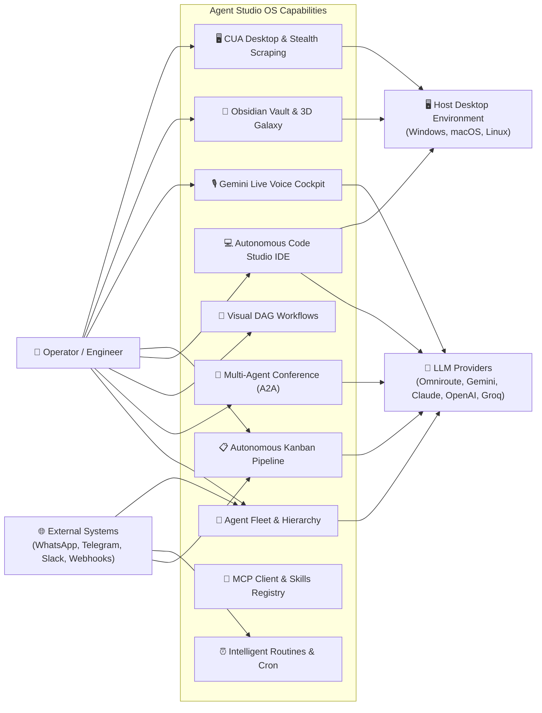

# Agent Studio OS - Comprehensive Use Cases Directory

## 📖 Executive Overview

Agent Studio OS is an autonomous AI agent orchestration operating system that enables users to create, coordinate, and deploy AI agent teams equipped with customizable tools, visual workflows, desktop GUI automation, and multi-provider LLM gateways.

Below is the definitive catalog of 85 verified use cases organized across 10 functional domains.

---

## 🗂️ Complete Catalog of Use Cases

### 1. 🤖 Agent Fleet & Hierarchy Management
1. **Create Agent Profile**: Configure a new agent with avatar, display name, role, system prompt, department, assigned model, theme color, and reporting hierarchy.
2. **Assign 4-Tier Hierarchy**: Assign an agent as Orchestrator, Manager, Specialist, or Worker, defining reporting relationships (`reportsTo`).
3. **Deploy Pre-Configured Agent Team Packs**: Deploy full teams in one click (Engineering Squad, Marketing Agency, Executive Staff).
4. **List & Filter Fleet**: View all agents in operational card grid or filter by department, status, and role.
5. **Interactive Hierarchy Tree View**: Explore reporting structures, subordinate links, and team relationships visually via `AgentHierarchyView`.
6. **Update Agent Directives**: Adjust system prompts, temperature, model overrides, and capabilities on-the-fly without service restart.
7. **Launch Hermes CLI Profile Terminal**: Open an in-browser terminal emulator executing commands within an agent's isolated profile.
8. **Export / Import Agent Configs**: Share or backup agent profiles as standardized JSON/YAML specifications.

### 2. 🛠️ Tool Execution & Model Context Protocol (MCP)
9. **List Available Built-in Tools**: Inspect all available native tools (Terminal, Files, Code Exec, Search, Scrape, CUA, Memory, Todo, TTS).
10. **Enable/Disable Tools per Agent**: Granularly toggle tool permissions for individual agents.
11. **Connect External MCP Server (STDIO)**: Connect local subprocess MCP servers (e.g., SQLite, GitHub, Filesystem).
12. **Connect External MCP Server (SSE)**: Connect remote HTTP Server-Sent Events MCP servers over network endpoints.
13. **Auto-Discover MCP Tools**: Automatically detect and expose tools from configured MCP servers into agent execution prompts.
14. **Self-Healing Tool Execution**: Execute tools with automated syntax correction, parameter healing, and fallback cascading.
15. **Sandboxed Code Execution**: Run Python, JavaScript, and shell code in an isolated execution sandbox.
16. **Dynamic External Skill Installation**: Discover, install, and activate modular external skills (e.g., Banner Design, BigQuery SQL).

### 3. 📱 Omnichannel Messaging & Hardware Integrations
17. **Pair Personal WhatsApp via QR Code**: Connect personal WhatsApp via Baileys QR code pairing to converse with designated agents.
18. **Configure WhatsApp Business Cloud API**: Connect official Meta WhatsApp Cloud API webhooks for enterprise team access.
19. **Deploy Telegram Bot Gateway**: Link a Telegram bot token to enable mobile two-way chat and task dispatching.
20. **Connect Slack Workspace App**: Integrate Slack with slash commands (`/task`, `/briefing`, `/status`) and webhook dispatching.
21. **Configure Discord & Signal Bridges**: Bring agent teams into existing community and encrypted channels.
22. **Inbound HTTP Webhook Subscriptions**: Configure webhook listener URLs to trigger agent workflows from external SaaS events.
23. **Simulate Inbound Webhook Payloads**: Test webhook trigger behaviors using the built-in interactive Webhook Simulator.
24. **Channel Connectivity Diagnostics**: Perform live ping and payload verification across all configured messaging channels.

### 4. 💬 Chat, Multimodal Voice & Multi-Agent Conference
25. **Single-Turn & Multi-Turn Agent Chat**: Engage in deep dialogue with context retention and persistent session storage.
26. **Persistent Global Floating Chat**: Chat panel remains active as a floating cockpit window while navigating between pages.
27. **Gemini Live Bidirectional Voice Streaming**: Real-time voice conversation over WebSockets with 16kHz in / 24kHz out audio.
28. **Floating Voice Orb HUD (`Alt + V`)**: Trigger the interactive Voice Orb from any screen with audio volume telemetry.
29. **3-Way Model Debate Arena**: Benchmark identical prompts across 3 competing models side-by-side with latency metrics.
30. **Reasoning Thought Process Inspector**: Inspect DeepSeek R1 and OpenAI o1/o3 internal reasoning chains before final output.
31. **Multi-Agent Conference Roundtable**: Host live collaborative sessions where agents debate, delegate, and synthesize missions.
32. **A2A (Agent-to-Agent) Execution Protocol**: Hierarchical task delegation from Orchestrator down to Managers and Specialists.
33. **Live Speech Synthesis (TTS)**: Listen to real-time auditory readouts of agent contributions in conference sessions.
34. **Live Conference Event Stream**: Monitor agent thoughts, speaking states, delegations, and phase conclusions in real time.
35. **Conference Deliverable Export**: Export conference minutes, action items, and executive summaries to Obsidian and Kanban.
36. **Branch Conversation Session**: Fork any conversation turn into an independent parallel thread for exploration.

### 5. 📋 Autonomous Kanban & Task Pipeline
37. **Create & Prioritize Kanban Tickets**: Add tasks with title, description, priority badge, and due date.
38. **Automatic Agent-to-Task Matching**: Automatically assign tasks to the best-suited specialist using semantic intent matching.
39. **1-Click Autonomous Execution**: Trigger the assigned agent to execute the ticket and compile deliverables to the vault.
40. **Multi-Agent Swarm Execution**: Automatically decompose massive tickets and spawn multiple agents in parallel.
41. **Agent Self-Reflection & Critique**: Instruct the agent to critique and refine its output before moving to Review.
42. **Subtask Deconstruction**: Automatically break down high-level tasks into granular checkable subtask items.
43. **Human-in-the-Loop Approval Gate**: Review deliverables in the Review column and mark them Done.
44. **Request Task Revision**: Provide specific critique feedback, prompting the agent to autonomously re-execute and revise.
45. **Task Rejection & Re-Delegation**: Reject deliverables with reasons and re-assign tickets to alternative specialists.
46. **Deliverable Vault Sync**: Automatically compile finished deliverables as structured Markdown notes in `/vault`.

### 6. 🔀 Visual DAG Workflow Automation Engine
47. **Visual Drag-and-Drop Workflow Canvas**: Design Directed Acyclic Graphs on an interactive pan-and-zoom surface.
48. **Wire Sequential & Parallel Execution Nodes**: Connect agent nodes, routers, and tools with interactive bezier edges.
49. **Add Conditional Branching Nodes**: Direct workflow execution paths based on dynamic rules or agent decisions.
50. **Insert Human Approval Gates**: Pause workflow execution until a user inspects and approves intermediate deliverables.
51. **Execute Pre-Built Workflow Presets**: Run pre-configured pipelines (Full-Stack SaaS Builder, Market Intelligence, Code Audit).
52. **Automated Cycle Detection & DAG Validation**: Prevent infinite loops using built-in graph cycle checkers (`wouldCreateCycle`).
53. **Auto-Layout Graph Canvas**: Automatically organize complex graphs using topological layout algorithms.
54. **Workflow Execution Step-by-Step / Wave**: Run nodes sequentially or in parallel dependency-aware execution waves.
55. **Export / Import Workflows as JSON**: Save and share custom workflow graph definitions.
56. **Compile Multi-Node Deliverables**: Aggregate outputs from all workflow nodes into a consolidated downloadable document.

### 7. 💻 Autonomous Code Studio & Web IDE
57. **Full-Featured In-Browser IDE**: Edit code across multi-file project workspaces with syntax highlighting and tabs.
58. **Multi-Viewport Responsive Sandbox Preview**: Live iframe preview toggling between Desktop, Tablet, and Mobile frames.
59. **Console Log Bridge**: View client-side `console.log`, warnings, and runtime errors in the integrated Console Drawer.
60. **Natural Language Project Scaffolding**: Prompt the AI Code Assistant to generate complete React, Next.js, or HTML5 apps.
61. **Autonomous Code Debugging & Fixing**: Send runtime console errors directly to the AI assistant to apply automated fixes.
62. **Visual Code Diff Modal**: Inspect side-by-side or unified diffs before accepting AI modifications to existing files.
63. **Multi-File Workspace Management**: Create, rename, delete, and upload files and folders in `/workspace`.
64. **1-Click Project ZIP Export**: Package and download the entire generated application workspace as a ZIP archive.
65. **Built-in Project Templates**: Scaffold new apps instantly from pre-configured templates (Vite, React, Next.js, Vanilla).

### 8. 🖥️ CUA Desktop Automation & Stealth Web Intelligence
66. **Autonomous Desktop App Launching**: Direct agents to launch local applications (Notepad, Calculator, VS Code) or web URLs.
67. **Automated High-Resolution Screenshot Capture**: Capture current desktop screen state and save as downloadable image assets.
68. **Embed Screenshots in Agent Chat**: Automatically display captured screen images inline in the chat conversation.
69. **Simulate Mouse Clicks & Scrolling**: Direct agents to click specific desktop coordinates, UI elements, or scroll viewports.
70. **Keyboard Typing & Hotkey Automation**: Direct agents to type text strings and trigger keyboard combinations (`Enter`, `Tab`).
71. **Stealth Web Scraping with Bot Bypass**: Scrape modern JavaScript-heavy and Cloudflare-protected web pages via Python Scrapling.
72. **Deep Recursive Domain Crawling**: Crawl entire websites up to configurable page limits with CSS selector filtering.
73. **HTML-to-Clean-Markdown Conversion**: Extract clean, readable Markdown from complex web layouts for agent reasoning.

### 9. 🌌 Memory, Obsidian Vault & 3D Knowledge Galaxy
74. **Bi-Directional Obsidian Sync**: Read from and write to the local `./vault` markdown repository in real time.
75. **Wikilink Resolution & Backlink Indexing**: Parse and index Obsidian-style `[[Note Name]]` links across all notes.
76. **Interactive 3D Galaxy Physics Graph**: Explore the knowledge base as a force-directed 3D network with starfield particles.
77. **Identify Central "God Nodes"**: Visually discover the highest-connected hub concepts across organizational intelligence.
78. **Dual-Pane In-App Markdown Studio**: Edit, format, and preview notes with GitHub Flavored Markdown support.
79. **Local Semantic RAG Retrieval**: Perform semantic search across vault documents to inject historical context into agent prompts.
80. **Episodic Memory Summarization**: Automatically compress and summarize long conversation threads into memory notes.

### 10. ⚙️ System Administration, Telemetry & Security
81. **Executive Daily Briefing**: Receive a synthesized AI summary of active tasks, overnight routines, and fleet telemetry upon login.
82. **Brain Dump Ingestion**: Dump voice or unstructured text notes; AI auto-sorts them into tasks and memory notes.
83. **Centralized Slash Commands**: Dispatch quick actions via 18 slash commands (`/goal`, `/plan`, `/code`, `/status`, etc.).
84. **Real-Time Token & Cost Telemetry**: Track prompt tokens, completion tokens, latency, and estimated USD spend across providers.
85. **One-Click Database Backup & Restore**: Export and import complete SQLite database backups directly from the UI.
86. **Provider Health & Ping Monitoring**: Benchmark latency and verify API key validity with a single click.
87. **Self-Hosted Data Sovereignty**: Run 100% locally with zero external telemetry or cloud dependencies.
88. **Enterprise Multi-Tenant Authentication**: Secure access via Clerk authentication with local guest fallback gates.

---

## 📊 Comprehensive Use Case Diagram

