# System Architecture

## High-Level System Design

Agent Studio OS follows a modular, fault-tolerant, multi-tier architecture centered around the **Omniroute Primary Brain Gateway** with automated, zero-downtime cascading multi-provider fallbacks. The system consists of six interconnected layers:

1. **Presentation & Interaction Layer**: Next.js 16 App Router with React 19 components providing the desktop GUI, mobile PWA responsiveness, floating Gemini Live Voice Orb, and persistent global chat cockpit.
2. **Brain Routing & Provider Layer**: Omniroute local gateway prioritization with instant fallback to direct cloud APIs (Google Gemini, Anthropic Claude, OpenAI, Groq, DeepSeek, OpenRouter) and local runtimes (Ollama, LM Studio).
3. **Workforce Operations Layer**: 4-tier hierarchical agent fleet (Orchestrators, Managers, Specialists, Workers), visual DAG workflow engine, multi-agent conference roundtable, autonomous Code Studio IDE, and autonomous Kanban task runner.
4. **Tool Runtime & Execution Layer**: Self-healing agentic tool loop, Computer-Using Agent (CUA) desktop controller, Python Scrapling bridge for stealth web crawling, Model Context Protocol (MCP) client manager (STDIO/SSE), and Hermes CLI profile sandboxes.
5. **Shared Memory & Knowledge Layer**: Obsidian-compatible Markdown vault with bi-directional sync, wikilink graph resolution, local RAG semantic search, and interactive 3D Knowledge Galaxy visualization.
6. **Omnichannel & Gateway Layer**: Mobile and messaging bridge connecting WhatsApp (QR pairing & Cloud API), Telegram Bot API, Slack workspace apps, Discord, and inbound/outbound HTTP webhooks.

```mermaid
graph TD
    User["🖥️ Desktop GUI / Mobile PWA / Voice Cockpit"] --> App["⚡ Next.js 16 App & API Router\n(React 19 + Tailwind CSS 4 + Clerk Auth)"]
    
    subgraph BrainRouting ["🧠 Intelligent Multi-Provider Brain Routing"]
        App --> PrimaryRouter["Omniroute Primary Brain\n(http://127.0.0.1:20128)"]
        PrimaryRouter -.->|Fallback / Direct| ProviderGateway["Direct Multi-Provider Fallback Gateway"]
        ProviderGateway --> Google["Google Gemini (2.5 Flash, 2.0 Flash, 1.5 Pro, Multimodal Live WS)"]
        ProviderGateway --> Anthropic["Anthropic (Claude 3.7 Sonnet, 3.5 Sonnet, 3.5 Haiku)"]
        ProviderGateway --> OpenAI["OpenAI (GPT-4o, GPT-4o Mini, o1, o3-mini)"]
        ProviderGateway --> Groq["Groq (Llama 3.3 70B, Llama 3.1 8B, DeepSeek R1 Distill)"]
        ProviderGateway --> DeepSeek["DeepSeek (V3 & R1)"]
        ProviderGateway --> OpenRouter["OpenRouter (300+ Models & Free Tier)"]
        ProviderGateway --> LocalLLM["Local Runtimes (Ollama, LM Studio)"]
    end
    
    subgraph OperationsHub ["🎛️ Agent Workforce & Operations"]
        App --> FleetHierarchy["4-Tier Role Hierarchy\n(Orchestrators, Managers, Specialists, Workers)"]
        FleetHierarchy --> ConferenceRoom["Autonomous Conference Room\n(A2A Hierarchy Protocol & Live Roundtables)"]
        FleetHierarchy --> DAGWorkflows["Visual DAG Workflow Canvas\n(Nodes, Edges, Topological Sort & Presets)"]
        FleetHierarchy --> CodeStudio["Autonomous Code Studio IDE\n(Multi-Viewport Live Preview & Console Drawer)"]
        FleetHierarchy --> KanbanRunner["Autonomous Kanban Runner\n(Swarm, Self-Reflection & Subtask Deconstruction)"]
        FleetHierarchy --> SchedulerEngine["Cron & Recurring Routines\n(Timezone-Aware & Webhook Simulator)"]
    end

    subgraph ToolingAndHardware ["🛠️ Tool Execution & Hardware Bridge"]
        App --> ToolLoop["Self-Healing Tool Execution Loop"]
        ToolLoop --> CUA["Computer-Using Agent (CUA)\n(Mouse, Keyboard, Window Launch, Screenshots)"]
        ToolLoop --> ScraplingBridge["Python Scrapling Bridge\n(Stealth Web Crawling, Bypass & Markdown Extraction)"]
        ToolLoop --> MCPClient["Model Context Protocol (MCP)\n(STDIO & SSE Transports)"]
        ToolLoop --> HermesBridge["Hermes Agent CLI & Profiles"]
        ToolLoop --> Omnichannel["Omnichannel Messaging\n(WhatsApp QR Pairing, Telegram Bot, Slack, Webhooks)"]
        ToolLoop --> Sandbox["Sandboxed Code Execution\n(Node.js, Python 3, Shell)"]
    end
    
    subgraph SharedMemory ["📚 Shared Obsidian Knowledge Infrastructure"]
        KanbanRunner -->|Auto-Saves Deliverables| Vault["Obsidian Markdown Vault (/vault)"]
        ConferenceRoom -->|Transcripts & Consensus| Vault
        SchedulerEngine -->|Logs Syntheses| Vault
        Vault --> Galaxy["3D Knowledge Galaxy Graph\n(Interactive Physics & Wikilinks)"]
        Vault --> LocalRAG["Local RAG Semantic Search\n(Cosine Similarity & Embeddings)"]
    end
```



---

## Tech Stack

### Frontend
- **Framework**: Next.js 16.3.5 (App Router with Server & Client Components)
- **UI Library**: React 19.2.8
- **Styling**: Tailwind CSS 4 with custom glassmorphism tokens and dark/light duality
- **Animations**: Framer Motion 13.3.0
- **Icons**: Lucide React
- **Notifications**: Sonner 2.0.8
- **Drag & Drop**: `@dnd-kit/core`, `@dnd-kit/sortable`, `@dnd-kit/utilities`
- **File Dropping**: `react-dropzone`
- **QR Code Generation**: `qrcode` (for WhatsApp pairing)
- **Archive Generation**: `jszip` (for Code Studio project export)
- **State Management**: React Context (`GlobalCockpitProvider`, `DashboardChatProvider`, `ProjectBuilderProvider`) and custom hooks

### Backend & API
- **Runtime**: Node.js (v20.0.0+)
- **API Architecture**: Next.js API Routes (25+ specialized route groups)
- **ORM**: Prisma 6.9.0 with SQLite
- **Database**: SQLite (`agent-studio.db`) hardened with WAL (Write-Ahead Logging) mode, busy timeouts, and memory caching
- **Authentication**: Clerk (`@clerk/nextjs`) with automated local guest fallback
- **Real-Time Streaming**: Server-Sent Events (`FleetEventBus`) and WebSockets (`GeminiLiveClient`)

### AI Routing & Runtimes
- **Primary Brain Gateway**: Omniroute local gateway client (`http://127.0.0.1:20128`)
- **Direct Cloud LLM Providers**:
  - Google Gemini (Gemini 2.5 Flash, 2.0 Flash, 1.5 Pro, Multimodal Live WebSockets)
  - Anthropic Claude (Claude 3.7 Sonnet, Claude 3.5 Sonnet, Claude 3.5 Haiku)
  - OpenAI (GPT-4o, GPT-4o Mini, o1, o3-mini)
  - Groq Cloud (Llama 3.3 70B, Llama 3.1 8B, DeepSeek R1 Distill)
  - DeepSeek (V3 and R1)
  - OpenRouter (300+ models with free-tier fallback)
- **Local LLM Runtimes**: Ollama and LM Studio endpoints
- **Voice Pipeline**: 16kHz PCM mono input, 24kHz PCM mono output with real-time audio scheduling

### Tooling & Integrations
- **Computer-Using Agent (CUA)**: Desktop automation driver (`cua-driver.ts`) with mouse, keyboard, app launching, and screenshot capture
- **Web Scraping & Crawling**: Python Scrapling bridge (`scrapling`, `curl_cffi`, `lxml`, `cssselect`) with Cloudflare bypass and stealth mode
- **Model Context Protocol (MCP)**: Client manager (`client-manager.ts`) supporting STDIO and SSE server transports
- **Omnichannel Messaging**: Native WhatsApp Personal (Baileys), WhatsApp Cloud API, Telegram Bot API, Slack, and Webhooks
- **Memory System**: Obsidian-compatible Markdown vault with wikilink parser and Three.js-style 3D Knowledge Galaxy

---

## Data Models

The system uses Prisma ORM with SQLite for persistent storage. Key entities in [schema.prisma](file:///c:/Users/rohan/Projects/Agent%20Os/agent-studio-os/prisma/schema.prisma) include:

### Core Entities

```prisma
model Agent {
  id           String             @id @default(cuid())
  userId       String?
  name         String
  displayName  String
  avatar       String             @default("🤖")
  systemPrompt String             @default("")
  model        String?
  themeColor   String             @default("#6366f1")
  status       String             @default("offline")
  profilePath  String?
  description  String             @default("")
  role         String             @default("specialist") // orchestrator, manager, specialist, worker
  department   String             @default("General")
  reportsToId  String?
  reportsTo    Agent?             @relation("AgentHierarchy", fields: [reportsToId], references: [id], onDelete: SetNull)
  subordinates Agent[]            @relation("AgentHierarchy")
  createdAt    DateTime           @default(now())
  updatedAt    DateTime           @updatedAt
  tasks        Task[]
  tools        AgentTool[]
  integrations AgentIntegration[]
  chatMessages ChatMessage[]
  sessions     ChatSession[]
  routines     Routine[]

  @@index([userId])
}

model Task {
  id          String    @id @default(cuid())
  userId      String?
  title       String
  description String    @default("")
  status      String    @default("backlog") // backlog, in_progress, review, done
  priority    String    @default("medium")  // low, medium, high, urgent
  position    Int       @default(0)
  dueDate     DateTime?
  agentId     String?
  agent       Agent?    @relation(fields: [agentId], references: [id], onDelete: SetNull)
  result      String    @default("")
  createdAt   DateTime  @default(now())
  updatedAt   DateTime  @updatedAt

  @@index([userId])
}

model Routine {
  id          String    @id @default(cuid())
  userId      String?
  title       String
  description String    @default("")
  prompt      String
  type        String    @default("daily") // daily, one_time
  time        String?   // e.g. "09:00" for daily schedule
  scheduledAt DateTime? // for one_time schedule
  enabled     Boolean   @default(true)
  autoExecute Boolean   @default(true)
  priority    String    @default("medium")
  agentId     String?
  agent       Agent?    @relation(fields: [agentId], references: [id], onDelete: SetNull)
  lastRunAt   DateTime?
  nextRunAt   DateTime?
  createdAt   DateTime  @default(now())
  updatedAt   DateTime  @updatedAt

  @@index([userId])
}

model ChatSession {
  id        String        @id @default(cuid())
  userId    String?
  title     String        @default("New Session")
  agentId   String
  agent     Agent         @relation(fields: [agentId], references: [id], onDelete: Cascade)
  model     String?
  pinned    Boolean       @default(false)
  summary   String?
  createdAt DateTime      @default(now())
  updatedAt DateTime      @updatedAt
  messages  ChatMessage[]

  @@index([agentId])
  @@index([userId])
}

model ChatMessage {
  id        String       @id @default(cuid())
  userId    String?
  role      String       // user, assistant, system
  content   String
  model     String?
  agentId   String?
  agent     Agent?       @relation(fields: [agentId], references: [id], onDelete: SetNull)
  latency   Int?
  tokens    Int?
  sessionId String?
  session   ChatSession? @relation(fields: [sessionId], references: [id], onDelete: Cascade)
  createdAt DateTime     @default(now())

  @@index([sessionId])
  @@index([agentId])
  @@index([userId])
}
```

### Supporting Entities
- `AgentTool`: Tool enablement configuration per agent (`toolId`, `enabled`).
- `AgentIntegration`: Platform credentials and channel configuration per agent (`platform`, `config`, `enabled`).
- `ActivityLog`: Real-time audit and activity logging (`type`, `message`, `agentId`, `metadata`).
- `Setting`: Key-value configuration storage for system preferences.

---

## Directory Architecture

```text
agent-studio-os/
├── prisma/
│   ├── schema.prisma         # SQLite database schema (Agents, Tasks, Routines, Logs)
│   └── agent-studio.db       # Local SQLite database (WAL mode)
├── src/
│   ├── app/
│   │   ├── page.tsx          # Executive Dashboard & Command Center
│   │   ├── agents/           # Fleet management, hierarchy tree & Hermes terminal
│   │   ├── chat/             # Persistent chat, 3-way debate arena & reasoning inspector
│   │   ├── code/             # Autonomous Code Studio IDE & responsive sandbox
│   │   ├── conference/       # Multi-agent conference roundtable & A2A protocol
│   │   ├── kanban/           # Autonomous Kanban board & task execution drawer
│   │   ├── memory/           # Obsidian vault manager & 3D Galaxy graph
│   │   ├── routines/         # Cron scheduler & inbound webhook simulator
│   │   ├── settings/         # Provider Hub, MCP config, Devices, Skills & Diagnostics
│   │   ├── workflows/        # Visual DAG workflow automation canvas
│   │   └── api/              # 25+ RESTful API route groups
│   ├── components/
│   │   ├── agents/           # Hierarchy view, pipeline builder, agent modals
│   │   ├── chat/             # Markdown renderer, chat sidebar, debate arena
│   │   ├── code/             # Code editor, live preview, console drawer, diff modal
│   │   ├── conference/       # Live event stream, inspector modal, artifact banner
│   │   ├── dashboard/        # Daily briefing, command bar, brain dump modal
│   │   ├── kanban/           # Kanban columns, cards, task drawer
│   │   ├── memory/           # 3D Obsidian Galaxy interactive physics canvas
│   │   ├── routines/         # Routine modals, deliverable viewer, webhook simulator
│   │   ├── telemetry/        # Real-time token usage and cost tracker modal
│   │   └── voice/            # Gemini Live interactive voice orb HUD
│   ├── lib/
│   │   ├── a2a/              # Agent-to-Agent hierarchy protocol & peer mesh
│   │   ├── mcp/              # Model Context Protocol client manager (STDIO & SSE)
│   │   ├── providers/        # Multi-provider LLM drivers (Gemini, Claude, OpenAI, etc.)
│   │   ├── agentic-tool-loop.ts # Multi-turn autonomous tool execution loop
│   │   ├── autonomous-action-dispatcher.ts # Natural language intent parser
│   │   ├── cua-driver.ts     # Computer-Using Agent desktop controller
│   │   ├── dag-engine.ts     # DAG workflow execution & topological sorting
│   │   ├── gemini-live-client.ts # WebSockets client for Gemini Multimodal Live API
│   │   ├── llm-router.ts     # Primary Brain router & cascade fallbacks
│   │   ├── project-filesystem.ts # Virtual workspace & project file management
│   │   ├── scrapling-bridge.ts # Python bridge for stealth web crawling & scraping
│   │   ├── self-healing-engine.ts # Automated error analysis & tool self-healing
│   │   ├── slash-commands.ts # Centralized slash command registry & routing
│   │   └── vault.ts          # Obsidian vault file system & wikilink resolution
│   └── types/                # Comprehensive TypeScript definitions
├── vault/                    # Real-time Obsidian shared memory markdown notes
└── README.md
```

---

## Architectural Principles

1. **Separation of Concerns**: Clean isolation between user interfaces, model routing, autonomous agent execution loops, and persistent knowledge storage.
2. **Zero-Downtime Fallback Resilience**: Any provider failure immediately triggers an automatic, seamless failover to secondary providers without dropping user tasks.
3. **Self-Healing Execution**: Tool failures and syntax exceptions are caught by the self-healing engine, analyzed with error reflection, and re-executed with corrected parameters.
4. **Hierarchical Organization**: Agents operate under structured reporting lines (Orchestrators ➔ Managers ➔ Specialists ➔ Workers), enabling natural delegation and mission breakdown.
5. **Persistent Knowledge Sovereignty**: All deliverables, conference syntheses, and routine logs are persisted as open Markdown in an Obsidian-compatible vault on the user's local disk.
6. **Extensible Protocol Architecture**: Native support for Model Context Protocol (MCP), Hermes skill profiles, and omnichannel messaging adapters.
7. **Complete Observability**: Real-time Server-Sent Events, token usage and cost telemetry, and execution latency tracking across all endpoints.