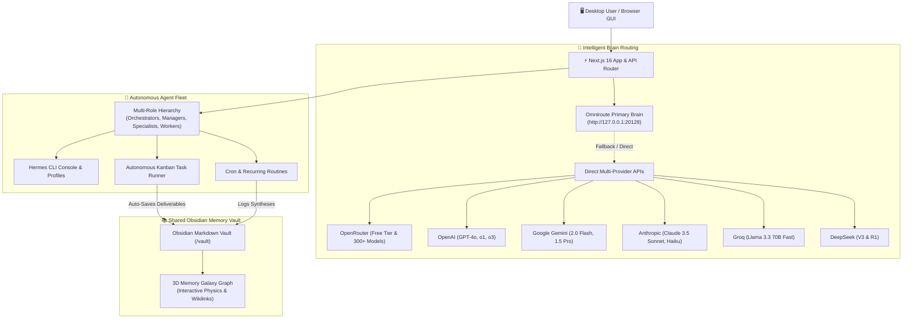

# Project Architecture

## High-Level System Design

Agent Studio OS follows a modular architecture centered around the **Omniroute Primary Brain Gateway** for intelligent LLM routing. The system consists of four interconnected layers:

1. **Presentation Layer**: Next.js 16 App Router with React 19 components providing the desktop GUI
2. **Brain Routing Layer**: Omniroute as primary router with fallback to direct multi-provider APIs
3. **Agent Runtime Layer**: Autonomous agent fleet organized in hierarchical roles (Orchestrators, Managers, Specialists, Workers)
4. **Shared Memory Layer**: Obsidian-compatible Markdown vault with 3D Knowledge Galaxy visualization

The architecture enables seamless communication between user interactions, intelligent model routing, autonomous agent execution, and persistent knowledge storage.



## Tech Stack

### Frontend
- **Framework**: Next.js 16.3.5 (App Router)
- **UI Library**: React 19.2.8
- **Styling**: Tailwind CSS 4 with glassmorphism design
- **Animations**: Framer Motion 13.3.0
- **Icons**: Lucide React
- **Notifications**: Sonner 2.0.8
- **Drag & Drop**: @dnd-kit/core
- **State Management**: React hooks and context

### Backend
- **Runtime**: Node.js (v20.0.0+)
- **API Routes**: Next.js API Routes
- **ORM**: Prisma 6.9.0 with SQLite
- **Database**: SQLite (agent-studio.db)
- **Authentication**: API key-based (stored in environment variables)

### Infrastructure
- **Primary Brain Gateway**: Omniroute (local model router)
- **Model Providers**: 
  - OpenRouter (300+ models, free tier)
  - OpenAI (GPT-4o, o1, o3 series)
  - Google Gemini (2.0 Flash, 1.5 Pro)
  - Anthropic (Claude 3.5 Sonnet, Haiku)
  - Groq (Llama 3.3 70B Fast)
  - DeepSeek (V3 & R1)
  - Additional providers via OpenRouter
- **Memory System**: Obsidian-compatible Markdown vault
- **Visualization**: Three.js-style 3D Knowledge Galaxy
- **Task Engine**: Autonomous Kanban pipeline with cron scheduler

### Development Tools
- **Type Checking**: TypeScript 5
- **Linting**: ESLint 9
- **Formatting**: Prettier (via eslint-config-next)
- **Package Manager**: npm/pnpm
- **Database Migrations**: Prisma CLI

## Data Models

The system uses Prisma ORM with SQLite for persistent storage. Key entities include:

### Core Entities
- **Agent**: Represents autonomous AI agents with hierarchical relationships
  - Fields: id, name, displayName, avatar, systemPrompt, model, themeColor, status, role (orchestrator/manager/specialist/worker), department, hierarchy relationships
  - Relationships: Tasks, Tools, Integrations, ChatMessages, Sessions, Routines

- **Task**: Work items managed through the Kanban system
  - Fields: id, title, description, status (backlog/in_progress/review/done), priority, position, dueDate
  - Relationships: Assigned Agent, Result

- **Routine**: Scheduled automated tasks
  - Fields: id, title, description, prompt, type (daily/one_time), time/scheduledAt, enabled, autoExecute, priority
  - Relationships: Assigned Agent, Execution tracking (lastRunAt/nextRunAt)

- **ChatSession & ChatMessage**: Conversation history and messaging
  - Sessions: Title, agent association, model, pinned flag, summary
  - Messages: Role, content, model association, latency, token usage, session/agent linking

### Supporting Entities
- **AgentTool**: Tools available to agents
- **AgentIntegration**: Platform integrations (WhatsApp, etc.)
- **Setting**: Key-value configuration storage
- **ActivityLog**: System activity tracking

### Relationships
- Agents form hierarchical trees via `reportsTo` self-referencing relationship
- Tasks and Routines can be assigned to Agents
- ChatSessions belong to Agents and contain ChatMessages
- All entities track creation/update timestamps

## Directory Structure

```
agent-studio-os/
├── prisma/
│   ├── schema.prisma         # SQLite database schema (Agents, Tasks, Routines, Logs)
│   └── agent-studio.db       # Local SQLite database
├── src/
│   ├── app/
│   │   ├── page.tsx          # Dashboard overview & activity feed
│   │   ├── agents/           # Agent fleet management & hierarchy views
│   │   ├── chat/             # Agent chat & 3-way model comparison arena
│   │   ├── kanban/           # Autonomous task Kanban board
│   │   ├── routines/         # Scheduled automation engine
│   │   ├── memory/           # Shared Obsidian memory & 3D Galaxy graph
│   │   ├── settings/         # Provider Hub, API keys & Model test suite
│   │   ├── api/              # Next.js API routes (chat, tasks, models, etc.)
│   │   ├── globals.css       # Design tokens & glassmorphism styling
│   │   └── layout.tsx        # Persistent shell with sidebar navigation
│   ├── components/
│   │   ├── agents/           # Agent cards, hierarchy tree, Hermes terminal
│   │   ├── memory/           # Memory Galaxy 3D interactive physics canvas
│   │   └── layout/           # Global collapsible navigation sidebar
│   ├── lib/
│   │   ├── llm-router.ts     # Primary Brain routing & multi-provider cascade
│   │   ├── omniroute.ts      # Omniroute gateway client & health checks
│   │   ├── hermes.ts         # Hermes Agent CLI subprocess bridge
│   │   ├── vault.ts          # Obsidian markdown vault synchronization
│   │   ├── scheduler.ts      # Background cron routine runner
│   │   └── prisma.ts         # Prisma client singleton
│   └── types/
│       └── index.ts          # TypeScript interfaces & system definitions
├── vault/                    # Real-time Obsidian shared memory markdown notes
└── README.md
```

## Architectural Principles

1. **Separation of Concerns**: Distinct layers for presentation, routing, agent execution, and memory
2. **Modularity**: Focused modules with single responsibilities (evidenced by refactored llm-router.ts)
3. **Fallback Resilience**: Intelligent routing with graceful degradation to direct provider APIs
4. **Hierarchical Organization**: Agent roles organized by responsibility level
5. **Persistent Knowledge**: All outputs stored in structured, interlinked Markdown format
6. **Extensibility**: Plugin-friendly architecture for adding new tools, integrations, and providers
7. **Observability**: Comprehensive logging, metrics tracking, and debugging capabilities